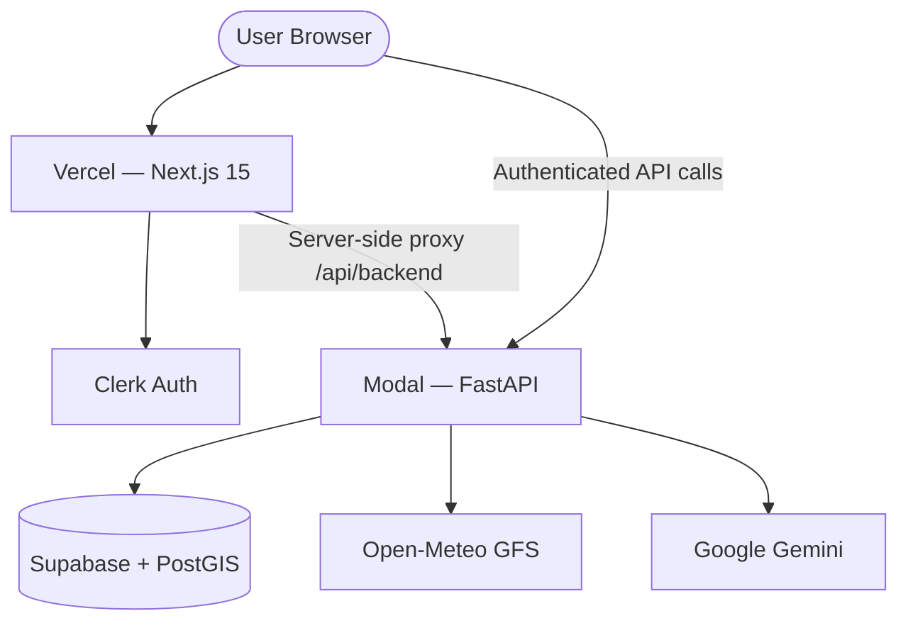

# AeroRoute

**Educational flight route optimization platform** for CONUS general aviation. Compare synthetic routes, factor in cruise-altitude GFS winds, estimate fuel and ETE, find diversion airports along a corridor, score route alternatives, and ask an AI copilot questions grounded in your route data.

> **Safety Disclaimer:** AeroRoute is an educational tool, **not** certified flight-planning software. It does not replace official briefings, ForeFlight/Garmin, FAA NOTAM checks, aircraft POH, dispatch, or pilot judgment. Always verify routes, weather, NOTAMs, fuel requirements, and airspace restrictions using official sources before any flight.

---

## Table of Contents

- [Features](#features)
- [Tech Stack](#tech-stack)
- [Architecture](#architecture)
- [How It Works](#how-it-works)
- [Project Structure](#project-structure)
- [Prerequisites](#prerequisites)
- [Local Setup & Run](#local-setup--run)
- [Environment Variables](#environment-variables)
- [Database & Migrations](#database--migrations)
- [ML Pipeline](#ml-pipeline)
- [AeroRoute Copilot](#aeroroute-copilot)
- [API Reference](#api-reference)
- [Testing](#testing)
- [Deployment](#deployment)
- [Security](#security)
- [Known Limitations](#known-limitations)
- [License](#license)

---

## Features

- **Airport search** — autocomplete over 85K+ OurAirports records (CONUS, K-ICAO, medium/large)
- **Route planning** — up to 5 synthetic candidates (direct, offset, diversion, weather checkpoint)
- **Wind-aware performance** — Open-Meteo GFS pressure-level winds at cruise altitude
- **Fuel model** — climb, cruise, descent, reserve (educational POH-style estimates)
- **Route scoring** — normalized 0–100 composite with preference modes (balanced, fastest, fuel saver, weather cautious)
- **Diversion search** — PostGIS corridor query ranked by distance and runway length
- **ML predictions** — delay risk (logistic regression) and ETE (random forest surrogate)
- **AeroRoute Copilot** — Gemini-powered, route-scoped RAG with intent routing and tool grounding
- **Interactive map** — Leaflet map with primary/alternate paths, diversions, checkpoints

---

## Tech Stack

| Layer | Technology |
|-------|------------|
| **Frontend** | Next.js 15, React 19, TypeScript, Tailwind CSS |
| **Auth** | Clerk (middleware-protected routes, JWT to API) |
| **Backend** | FastAPI (Python 3.11+), Uvicorn |
| **Database** | Supabase PostgreSQL + PostGIS |
| **Maps** | Leaflet / react-leaflet (lazy-loaded) |
| **Winds** | [Open-Meteo](https://open-meteo.com/) GFS pressure-level + surface fallback |
| **AI Copilot** | Google Gemini (`generativelanguage.googleapis.com`) |
| **ML** | scikit-learn (LogisticRegression, RandomForestRegressor), Parquet export |
| **Hosting** | Vercel (frontend), [Modal](https://modal.com/) (API) |
| **Testing** | pytest (~69 API tests), Playwright E2E |

---

## Architecture



**Production request flow:**

1. User signs in via **Clerk** on the Vercel frontend.
2. Browser calls the **Modal API** directly with a Clerk JWT (`Authorization: Bearer …`).
3. FastAPI validates the JWT (via `CLERK_JWKS_URL` in production), reads/writes **Supabase**, fetches winds from **Open-Meteo**, and calls **Gemini** for copilot chat.
4. A same-origin **`/api/backend/*` proxy** on Vercel is used for server components and as a local-dev fallback.

> **Note:** AviationWeather.gov and FAA live APIs are **disabled** in the current build. Route planning uses Open-Meteo winds, stored airport data, and educational scoring only.

---

## How It Works

### Route calculation pipeline

When a user submits **Calculate Route** (`POST /routes/calculate`):

```
1. Auth        Clerk JWT → user_id
2. Validate    Airports (CONUS, weather-eligible), aircraft profile, departure time window
3. Persist     route_requests row (status: processing)
4. Generate    Up to 5 route candidates in parallel:
                 • Direct great-circle
                 • North offset (~35 NM)
                 • South offset (~35 NM)
                 • Via best diversion airport (PostGIS corridor)
                 • Via best-weather en-route checkpoint
5. Winds       Open-Meteo GFS per segment at cruise pressure level (or surface fallback)
6. Performance ETE, fuel (climb + cruise + descent + reserve), cost
7. Score       Weighted 0–100 composite (time, fuel, weather, delay, diversion)
8. Select      Highest score → primary; second highest → alternate
9. Persist     route_results, route_segments, diversion_airports
10. ML log     model_training_samples + model_predictions (delay + ETE)
11. Return     Full route result → frontend navigates to /routes/{id}
```

**Wind model:** Cruise altitude maps to the nearest GFS pressure level (1000–200 hPa). Segment winds are sampled at leg midpoints. Groundspeed = cruise speed − headwind + tailwind.

**Fuel model (educational):**

```
trip_fuel   = climb + cruise + descent
reserve     = (reserve_fuel_min / 60) × fuel_burn_gph
total       = trip_fuel + reserve
```

**Scoring components (0–100, higher is better):**

| Component | Based on |
|-----------|----------|
| Time | ETE vs no-wind baseline |
| Fuel | Trip + reserve vs baseline |
| Weather | Dep/dest category + checkpoint penalties |
| Delay | Rules-based delay signals |
| Diversion | Corridor airport availability and runway length |

### ML pipeline

After each route calculation, two training samples are logged:

| Target | Label source | Model |
|--------|--------------|-------|
| `delay_risk` | `rules_label_v1` (low/medium/high) | LogisticRegression |
| `ete_prediction` | `deterministic_engine_v1` (surrogate) | RandomForestRegressor |

Export Parquet datasets from Supabase, train locally, and deploy `.joblib` artifacts to `apps/api/ml/artifacts/`. Inference falls back to rules/deterministic engine when no artifact exists.

### Copilot pipeline

```
1. User question → intent classification (weather, wind, fuel, diversion, delay, score, compare)
2. Intent selects grounded tools (get_route_summary, get_segment_wind_summary, get_fuel_breakdown, …)
3. Tool results + slim route context bundled as JSON
4. Gemini generateContent with strict system prompt (no invented NOTAMs/weather)
5. Response + mandatory safety disclaimer returned to UI
```

Copilot runs entirely on the **Modal API**. Gemini keys belong in Modal secrets, not Vercel.

---

## Project Structure

```
AeroRoute/
├── apps/
│   ├── web/                    # Next.js 15 frontend (Vercel root)
│   │   ├── src/app/            # App Router pages
│   │   ├── src/components/     # UI, map, copilot, live data cards
│   │   ├── src/lib/            # API client, route cache, map utils
│   │   └── e2e/                # Playwright tests
│   └── api/                    # FastAPI backend
│       ├── app/
│       │   ├── routers/        # HTTP routes
│       │   └── services/       # Route calc, scoring, winds, copilot, ML logging
│       ├── ml/                 # Train scripts + artifacts
│       ├── tests/              # pytest suite
│       └── modal_app.py        # Modal deployment entrypoint
├── scripts/                    # Airport import, ML dataset generation/export
├── data/
│   ├── raw/                    # OurAirports CSV (~85K airports)
│   └── ml/                     # Exported Parquet training data
└── supabase/migrations/        # 001–008 SQL migrations
```

---

## Prerequisites

- **Node.js** 20+
- **Python** 3.11 (see `.python-version`). Modal runs 3.11 and installs the hashed `apps/api/requirements.lock`; Python 3.9 is end-of-life and no longer supported
- **Supabase** project with PostGIS enabled
- **Clerk** application ([clerk.com](https://clerk.com))
- **Google AI Studio** API key (optional, for copilot)

---

## Local Setup & Run

### 1. Clone and install

```bash
git clone https://github.com/AnikMajumdar/AeroRoute.git
cd AeroRoute
npm install
npm run setup:api    # creates apps/api/.venv (Python 3.11) and installs apps/api/requirements-dev.txt
```

Runtime dependencies live in `apps/api/requirements.txt`; test, ML-training and tooling packages live in `apps/api/requirements-dev.txt`. After changing runtime dependencies, regenerate the production lock file:

```bash
uv pip compile apps/api/requirements.txt --python-version 3.11 --universal --generate-hashes -o apps/api/requirements.lock
```

### 2. Configure environment

```bash
cp apps/api/.env.example apps/api/.env
cp apps/web/.env.example apps/web/.env.local
```

Fill in Supabase and Clerk keys (see [Environment Variables](#environment-variables)).

### 3. Apply migrations and import airports

In the Supabase SQL editor, run migrations **001 through 008** in order (`supabase/migrations/`).

Then import airport data:

```bash
npm run import:airports
```

### 4. Start development servers

```bash
npm run dev          # web :3000 + api :8000
```

Open [http://localhost:3000](http://localhost:3000), sign in, and plan a route at `/routes/new`.

### npm scripts

| Command | Description |
|---------|-------------|
| `npm run dev` | Start web + API concurrently |
| `npm run dev:web` | Next.js only (:3000) |
| `npm run dev:api` | FastAPI only (:8000) |
| `npm run build:web` | Production frontend build |
| `npm run test:api` | Run pytest |
| `npm run test:web` | Run Playwright E2E |
| `npm run import:airports` | Load OurAirports CSV into Supabase |
| `npm run deploy:api` | Deploy API to Modal |
| `npm run ml:generate` | Generate training route samples |
| `npm run ml:export-delay` | Export delay risk Parquet |
| `npm run ml:export-ete` | Export ETE Parquet |
| `npm run ml:train-delay` | Train delay risk model |
| `npm run ml:train-ete` | Train ETE model |

---

## Environment Variables

### Backend — `apps/api/.env`

| Variable | Required | Description |
|----------|----------|-------------|
| `SUPABASE_URL` | **Yes** | Supabase project URL |
| `SUPABASE_SERVICE_ROLE_KEY` | **Yes** | Service role key (backend only — never expose to frontend) |
| `CLERK_SECRET_KEY` | **Yes** | Clerk secret key |
| `CLERK_JWKS_URL` | Prod | Clerk JWKS URL for JWT validation |
| `CLERK_ISSUER` | Prod | Clerk issuer URL |
| `API_CORS_ORIGINS` | Prod | Comma-separated origins, e.g. `http://localhost:3000,https://your-app.vercel.app` |
| `APP_ENV` | No | `development` or `production` |
| `COPILOT_ENABLED` | Copilot | `true` to enable |
| `GEMINI_API_KEY` | Copilot | Google AI Studio key |
| `GEMINI_MODEL` | No | Default `gemini-2.5-flash-lite` |

Aviation weather and FAA variables are reserved for future use — integrations are **disabled** in the current build.

### Frontend — `apps/web/.env.local`

| Variable | Required | Description |
|----------|----------|-------------|
| `NEXT_PUBLIC_API_URL` | **Yes** | `http://localhost:8000` locally; Modal URL in production |
| `NEXT_PUBLIC_CLERK_PUBLISHABLE_KEY` | **Yes** | Clerk publishable key |
| `CLERK_SECRET_KEY` | **Yes** | Clerk secret (server-side in Next.js) |
| `NEXT_PUBLIC_APP_ENV` | No | `development` or `production` |

**Do not** put `GEMINI_API_KEY` or `SUPABASE_SERVICE_ROLE_KEY` in the frontend.

---

## Database & Migrations

Apply in order via Supabase SQL editor:

| Migration | Purpose |
|-----------|---------|
| `001_initial_schema.sql` | Core tables: airports, aircraft, routes, segments, diversions |
| `002_update_aircraft_presets.sql` | Aircraft performance fields |
| `003_phase2_accuracy.sql` | Wind altitude columns on segments |
| `004_rls_policies.sql` | Row-level security |
| `005_faa_status_on_results.sql` | FAA status on results |
| `006_ml_pipeline.sql` | ML training samples and predictions |
| `007_fix_diversion_postgis.sql` | PostGIS diversion corridor fix |
| `008_live_data.sql` | Live data snapshots (TFR/NOTAM/hazard storage) |

**Key tables:**

- `airports` — coordinates, PostGIS `geom`, runway length
- `aircraft_profiles` — cruise speed, fuel burn, altitude, climb/descent/reserve
- `route_requests` / `route_results` — user routes, metrics, paths, scores
- `route_segments` — per-leg winds, groundspeed, ETE
- `diversion_airports` — corridor search results
- `model_training_samples` / `model_predictions` — ML pipeline
- `live_data_snapshots` — optional live restriction/hazard snapshots
- `route_briefs` — deterministic and copilot chat logs

---

## ML Pipeline

### Generate training data

```bash
# Dry run first
npm run ml:generate -- --dry-run --max-samples 10

# Generate routes against your Supabase instance
npm run ml:generate -- --max-samples 50 --delay 2
```

### Export and train

```bash
npm run ml:export-delay    # → data/ml/delay_risk_training_v1.parquet
npm run ml:export-ete      # → data/ml/ete_training_v1.parquet
npm run ml:train-delay     # → apps/api/ml/artifacts/delay_risk_model_v1.joblib
npm run ml:train-ete       # → apps/api/ml/artifacts/ete_model_v1.joblib
```

**Surrogate ETE warning:** ETE labels come from the deterministic engine until real track/ADS-B data is added. ML-adjusted ETE is educational only.

---

## AeroRoute Copilot

Enable locally in `apps/api/.env`:

```bash
COPILOT_ENABLED=true
GEMINI_API_KEY=your-key-from-aistudio.google.com
GEMINI_MODEL=gemini-2.5-flash-lite
```

Restart the API. The route result page shows **Online** when `/copilot/status` returns `enabled: true`.

**Capabilities:**

- Route-scoped RAG — answers only from stored route context + intent-selected tools
- Intent routing — weather, wind, fuel, diversion, delay, score, compare
- Suggested questions per route
- Mandatory safety disclaimers; never invents NOTAMs or live weather

**Production:** Set `GEMINI_API_KEY` and `COPILOT_ENABLED=true` in Modal secret `aeroroute-secrets`, then `npm run deploy:api`.

Verify: `GET https://your-modal-url.modal.run/copilot/status`

---

## API Reference

| Method | Path | Auth | Description |
|--------|------|------|-------------|
| GET | `/health` | No | Health check |
| GET | `/copilot/status` | No | Copilot enabled/model |
| GET | `/airports/search?q=` | No | Airport autocomplete |
| GET | `/aircraft/presets` | No | Aircraft profiles |
| GET | `/routes` | Yes | List user's saved routes |
| POST | `/routes/calculate` | Yes | Calculate route (10/min rate limit) |
| GET | `/routes/{id}` | Yes | Full route result |
| POST | `/routes/{id}/brief/draft` | Yes | Deterministic briefing |
| GET | `/routes/{id}/copilot/suggestions` | Yes | Route-specific copilot questions |
| POST | `/routes/{id}/copilot/chat` | Yes | Gemini copilot chat |
| POST | `/routes/{id}/live-data/refresh` | Yes | Refresh live data snapshot |

Interactive docs: `http://localhost:8000/docs` (local) or `{MODAL_URL}/docs` (production).

---

## Testing

```bash
npm run test:api     # pytest — routing, scoring, winds, copilot, ML, live data
npm run test:web     # Playwright E2E — route form, result page, copilot UI
```

E2E runs with `E2E_TEST_MODE=true` and mock route data (no live API required for most UI tests).

---

## Deployment

### Backend — Modal

```bash
# One-time setup
pip install modal
modal token set

# Create or update secret (all production env vars)
modal secret create aeroroute-secrets \
  SUPABASE_URL=https://xxx.supabase.co \
  SUPABASE_SERVICE_ROLE_KEY=... \
  CLERK_SECRET_KEY=sk_... \
  CLERK_JWKS_URL=https://your-clerk-domain/.well-known/jwks.json \
  CLERK_ISSUER=https://your-clerk-domain \
  GEMINI_API_KEY=... \
  COPILOT_ENABLED=true \
  GEMINI_MODEL=gemini-2.5-flash-lite \
  API_CORS_ORIGINS=https://your-app.vercel.app,http://localhost:3000 \
  APP_ENV=production

# Deploy
npm run deploy:api
```

Note the deployed URL (e.g. `https://user--aeroroute-api-fastapi-app.modal.run`).

### Frontend — Vercel

1. Import the GitHub repo in [Vercel](https://vercel.com).
2. **Root directory:** `apps/web`
3. **Install command:** `cd ../.. && npm install` (configured in `apps/web/vercel.json`)
4. **Environment variables:**

   | Variable | Value |
   |----------|-------|
   | `NEXT_PUBLIC_API_URL` | Modal backend URL |
   | `NEXT_PUBLIC_CLERK_PUBLISHABLE_KEY` | Clerk publishable key |
   | `CLERK_SECRET_KEY` | Clerk secret key |
   | `NEXT_PUBLIC_APP_ENV` | `production` |

5. In **Clerk → Domains**, add your Vercel URL.
6. Deploy and verify: sign in → calculate route → view map → ask copilot.

### Production checklist

- [ ] Supabase migrations 001–008 applied
- [ ] Airports imported (`npm run import:airports`)
- [ ] Modal secret configured and API deployed
- [ ] Vercel env vars set (especially `NEXT_PUBLIC_CLERK_PUBLISHABLE_KEY`)
- [ ] Clerk allowed origins include Vercel domain
- [ ] `API_CORS_ORIGINS` on Modal includes Vercel URL
- [ ] `/copilot/status` returns `enabled: true` (if using copilot)

---

## Security

- **Clerk JWT** validated via `CLERK_JWKS_URL` in production; `X-User-Id` header accepted in dev only
- **Supabase RLS** on user-owned data; API uses service role
- **Rate limiting** on `POST /routes/calculate` — 10 requests/min per user (in-memory; use Redis for multi-instance)
- **Secrets** — never commit `.env` files; never expose service role key or Gemini key in the frontend bundle
- **Copilot guardrails** — system prompt forbids inventing NOTAMs, weather, or operational approval language

---

## Data Sources

| Source | Usage | Status |
|--------|-------|--------|
| [OurAirports](https://ourairports.com/data/) | Airport/runway data (~85K records) | Active (static import) |
| [Open-Meteo](https://open-meteo.com/) | GFS pressure-level + surface winds | Active |
| AviationWeather.gov | METAR/TAF/PIREP/SIGMET | **Disabled** |
| FAA NAS / TFR / NOTAM | Delays, restrictions | **Disabled** |

Routes are **synthetic great-circle paths** with optional waypoints — not published airways, SIDs, or STARs.

---

## Known Limitations

- **Educational only** — not certified for operational flight planning
- **CONUS-focused** — K-ICAO medium/large airports
- **Synthetic routes** — not airways or procedures
- **GFS winds** — model estimates, not actual winds aloft
- **No live METAR/TAF/TFR/NOTAM** in current build
- **Rate limiting** — in-memory on a single API instance
- **Delay ML** — needs ≥300 samples, multiple classes to train reliably
- **ETE ML** — surrogate labels from deterministic engine
- **Copilot latency** — Gemini calls may take 15–45 seconds

---

## License

Educational use. See safety disclaimer above.
