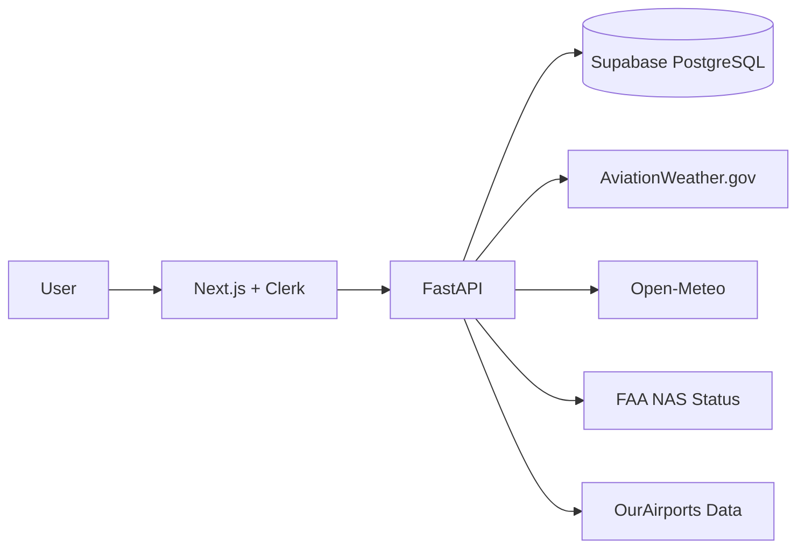

# AeroRoute

**Educational flight route optimization platform** — compare routes, factor in weather and winds, find diversion airports, and understand route scoring.

> **Safety Disclaimer:** AeroRoute is an educational tool, **not** certified flight-planning software. Always verify routes, weather, NOTAMs, fuel requirements, and airspace restrictions using official sources (FAA, ICAO, operator manuals) before any flight.

## Tech Stack

| Layer | Technology |
|-------|-----------|
| Frontend | Next.js 15, React 19, TypeScript, Tailwind CSS |
| Auth | Clerk |
| Backend | FastAPI (Python) |
| Database | Supabase PostgreSQL + PostGIS |
| Maps | Leaflet / react-leaflet |
| Background jobs | Structured for Modal (sync for now) |
| Testing | pytest (backend), Playwright (frontend) |

## Architecture

```
AeroRoute/
├── apps/
│   ├── web/          # Next.js frontend
│   └── api/          # FastAPI backend
├── scripts/          # Data import scripts
├── data/
│   ├── raw/          # OurAirports CSV files
│   └── processed/    # Processed data
└── supabase/
    └── migrations/   # Database schema
```



## Data Sources

| Source | Usage | Cache TTL |
|--------|-------|-----------|
| [OurAirports](https://ourairports.com/data/) | Airport/runway data | Static import |
| [AviationWeather.gov](https://aviationweather.gov/data/api/) | METAR/TAF | 5–15 min |
| [Open-Meteo](https://open-meteo.com/) | Forecast winds | 30–60 min |
| [FAA NAS Status](https://nasstatus.faa.gov/) | Airport delays/closures | 5–10 min |

## Database Schema

- **airports** — ICAO/IATA codes, coordinates, type, longest runway
- **aircraft_profiles** — Preset and user-defined aircraft (speed, fuel burn)
- **route_requests** — User route calculation requests with job status
- **route_results** — Primary/alternate route metrics, paths, scores
- **route_segments** — Per-leg wind-adjusted segment details
- **diversion_airports** — Ranked diversion airports along corridor
- **api_cache** — External API response cache

## Route Scoring Formula

```
score = ETE_minutes + fuel_penalty + delay_penalty + weather_penalty + diversion_penalty
```

| Component | Calculation |
|-----------|------------|
| ETE minutes | Wind-adjusted estimated time en route |
| Fuel penalty | `max(0, fuel_burn - baseline) × 2` |
| Delay penalty | Dep/dest delay minutes + 120 if closed + 60 if ground stop |
| Weather penalty | LIFR: 60, IFR: 40, MVFR: 20, VFR: 0 (per airport) |
| Diversion penalty | 50 if none found, 20 if shortest runway < 3000 ft |

Three route variants are generated (direct, north-offset midpoint, south-offset midpoint). Lowest score = primary, second lowest = alternate.

## Local Setup

### Prerequisites

- Node.js 20+
- Python 3.11+
- Supabase project (with PostGIS enabled)
- Clerk application

### 1. Clone and install

```bash
cd AeroRoute
npm install
npm run setup:api
```

`setup:api` creates the Python virtualenv in `apps/api/.venv` and installs dependencies. Required before the API can start.

### 2. Configure environment

```bash
cp apps/api/.env.example apps/api/.env
cp apps/web/.env.example apps/web/.env.local
```

Fill in your Supabase and Clerk credentials.

### 3. Run database migration

Apply `supabase/migrations/001_initial_schema.sql` in your Supabase SQL editor.

### 4. Import airport data

Download `airports.csv` and `runways.csv` from [OurAirports](https://ourairports.com/data/) into `data/raw/`, then:

```bash
npm run import:airports
```

### 5. Start development servers

```bash
# Both servers (recommended)
npm run dev

# Or separately:
npm run dev:api   # http://localhost:8000
npm run dev:web   # http://localhost:3000
```
- API docs: http://localhost:8000/docs

### 6. Run tests

```bash
npm run test:api
npm run test:web
```

## API Endpoints

| Method | Path | Description |
|--------|------|-------------|
| GET | `/health` | Health check |
| GET | `/airports/search?q=` | Airport autocomplete |
| GET | `/aircraft/presets` | Preset aircraft profiles |
| POST | `/aircraft` | Create custom aircraft |
| GET | `/routes` | List user's saved routes |
| POST | `/routes/calculate` | Calculate and save route |
| GET | `/routes/{id}` | Get route result details |

## Route Job Statuses

Routes progress through: `pending` → `processing` → `completed` / `failed`

The architecture supports future Modal background job integration.

## Future Improvements

- Modal background job processing for long routes
- PostGIS-optimized diversion airport queries
- NOTAM integration
- Airspace restriction overlays
- Multi-leg routing with fuel stops
- User aircraft profile management UI
- Route sharing and export (PDF/GPX)
- Redis cache layer for high-traffic deployments

## License

Educational use. See safety disclaimer above.
# AeroRoute
