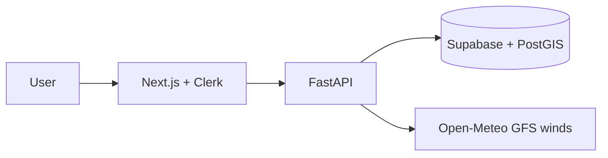

# AeroRoute

**Educational flight route optimization platform** — compare routes, factor in cruise-altitude winds and weather, find diversion airports, and understand normalized route scoring.

> **Safety Disclaimer:** AeroRoute is an educational tool, **not** certified flight-planning software. It does not replace official briefings, ForeFlight/Garmin, FAA NOTAM checks, aircraft POH, dispatch, or pilot judgment. Always verify routes, weather, NOTAMs, fuel requirements, and airspace restrictions using official sources before any flight.

## Tech Stack

| Layer | Technology |
|-------|-----------|
| Frontend | Next.js 15, React 19, TypeScript, Tailwind CSS |
| Auth | Clerk |
| Backend | FastAPI (Python 3.11+) |
| Database | Supabase PostgreSQL + PostGIS |
| Maps | Leaflet / react-leaflet |
| Testing | pytest (backend), Playwright (frontend) |

## Architecture

```
AeroRoute/
├── apps/
│   ├── web/          # Next.js frontend
│   └── api/          # FastAPI backend
├── scripts/          # Data import scripts
├── data/raw/         # OurAirports CSV files
└── supabase/migrations/
```



> **Note:** AviationWeather.gov and FAA live APIs are **not connected** in the current build. Route planning uses Open-Meteo winds, airport geometry, and educational scoring only.

## Data Sources & Limitations

| Source | Usage | Status |
|--------|-------|--------|
| [OurAirports](https://ourairports.com/data/) | Airport/runway data | Active (static import) |
| [Open-Meteo](https://open-meteo.com/) | GFS pressure-level + surface winds | Active |
| AviationWeather.gov | METAR/TAF/PIREP/SIGMET | **Disabled** — verify via official briefings |
| FAA NAS / TFR / NOTAM | Delays, restrictions | **Disabled** — verify via official briefings |

Routes are **synthetic great-circle paths** with optional waypoints — not published airways or SID/STAR procedures.

## Database Schema (key tables)

- **airports** — coordinates, `geom` geography point, runway length
- **aircraft_profiles** — cruise speed, fuel burn, cruise altitude, climb/descent/reserve, min runway
- **route_requests** — user, airports, aircraft, `route_preference`, job status
- **route_results** — primary/alternate metrics, fuel breakdown, score breakdown, weather checkpoints
- **route_segments** — per-leg winds (altitude, pressure level, headwind/tailwind), groundspeed, ETE
- **diversion_airports** — PostGIS corridor search results
- **route_briefs** — deterministic (and future LLM) briefings
- **model_training_samples** / **model_predictions** — ML foundation
- **airport_status_snapshots** — raw/parsed FAA NAS status

Apply migrations in order through `007_fix_diversion_postgis.sql`.

## Machine Learning

### Training data pipeline

After each route calculation, AeroRoute logs two `model_training_samples` rows:

| Target | Label source | Features |
|--------|--------------|----------|
| `delay_risk` | `rules_label_v1` (low/medium/high) | FAA status, METAR categories, winds, diversions, scores |
| `ete_prediction` | `deterministic_engine_v1` (surrogate) | Distance, aircraft, winds, segments, scores |

### Generate & export datasets

```bash
# Generate routes (dry-run first)
python scripts/generate_training_routes.py --dry-run --max-samples 10
python scripts/generate_training_routes.py --max-samples 50 --delay 2

# Export from Supabase
python scripts/export_delay_dataset.py
python scripts/export_ete_dataset.py
```

Outputs: `data/ml/delay_risk_training_v1.parquet`, `data/ml/ete_training_v1.parquet`

### Train models

```bash
cd apps/api
python ml/train_delay_model.py
python ml/train_ete_model.py
```

Artifacts: `apps/api/ml/artifacts/delay_risk_model_v1.joblib`, `ete_model_v1.joblib` + metadata JSON.

### Inference

- **Delay risk:** `LogisticRegression` (or rules fallback if no artifact)
- **ETE:** `RandomForestRegressor` (or deterministic ETE if no artifact)

**Surrogate ETE warning:** ETE labels come from the deterministic engine until real track/ADS-B data is added. ML-adjusted ETE is educational only.

### Metrics (after training on your data)

Delay: accuracy, macro F1, confusion matrix. ETE: MAE, RMSE, MAPE (stored in metadata JSON).

## AeroRoute Copilot

- **Route-scoped RAG** — answers only from `get_route_context()` + intent-selected tools
- **Intent routing** — weather, wind, fuel, diversion, delay, score explanation, compare
- **Tool grounding** — `get_route_summary`, `get_segment_wind_summary`, `get_fuel_breakdown`, etc.
- **Route-specific suggestions** — `GET /routes/{id}/copilot/suggestions`
- **Source timestamps** — METAR/TAF/FAA refresh times included in context
- **Limitations** — no NOTAMs, no invented airports/weather; operational answers include safety note

## Performance

| Optimization | Details |
|--------------|---------|
| Parallel external calls | METAR/TAF/FAA fetched with `asyncio.gather` |
| Parallel route variants | 5 candidates computed concurrently |
| Parallel wind legs | Open-Meteo per-leg `gather` |
| Caching | METAR 5m, TAF 15m, FAA 5m, wind 30m (Supabase `api_cache`) |
| Slim copilot context | Full segments only for wind intent |
| Lazy map | `next/dynamic` Leaflet on result page |

Optional `ASYNC_ROUTE_CALC=true` in API env for future background job mode.

## Future AI/ML Roadmap

- ~~Copilot (RAG)~~ implemented with intent routing
- ~~Delay risk model~~ LogisticRegression + rules fallback
- ~~ETE model foundation~~ surrogate RandomForest
- Real ADS-B / track data for ETE labels
- NOTAM tool-calling for copilot

## Wind Model

Cruise altitude maps to the nearest Open-Meteo GFS pressure level (1000–200 hPa). Segment winds are sampled at leg midpoints using `windspeed_{level}hPa` and `winddirection_{level}hPa`. If pressure-level data is missing, the system falls back to 10 m surface winds and marks `wind_data_quality` as `surface_fallback`.

Headwind/tailwind components adjust groundspeed: `groundspeed = cruise_speed - headwind + tailwind`.

## Fuel Model (Educational)

```
trip_fuel = climb_fuel + cruise_fuel + descent_fuel
reserve_fuel = (reserve_fuel_min / 60) × fuel_burn_gph
total_required = trip_fuel + reserve_fuel
```

Aircraft presets include typical POH-style planning values. Fuel margin warnings are informational only.

## Route Scoring (0–100)

Each route candidate receives component scores (0 = poor, 100 = excellent):

| Component | Based on |
|-----------|----------|
| Time | ETE vs no-wind baseline |
| Fuel | Trip + reserve vs baseline |
| Weather | Dep/dest METAR category + checkpoint penalties |
| Delay | FAA NAS delays, closures, ground stops |
| Diversion | Corridor airport availability and runway length |

**Composite score** = weighted sum of components. Higher is better.

### Route Preference Modes

| Mode | Emphasis |
|------|----------|
| Balanced | Equal weights |
| Fastest | Time weight ↑ |
| Fuel Saver | Fuel weight ↑ |
| Weather Cautious | Weather weight ↑ |

## Route Candidates

Up to five variants are generated and scored:

1. Direct
2. North offset (~35 NM)
3. South offset (~35 NM)
4. Via best diversion airport (if found)
5. Via best-weather en-route checkpoint (if applicable)

Highest composite score = primary; second highest = alternate.

## Local Setup

### Prerequisites

- Node.js 20+
- Python 3.11+
- Supabase project (PostGIS enabled)
- Clerk application

### Install

```bash
cd AeroRoute
npm install
npm run setup:api
```

### Environment

```bash
cp apps/api/.env.example apps/api/.env
cp apps/web/.env.local.example apps/web/.env.local
```

Optional API vars: `CLERK_JWKS_URL` (JWT validation), `COPILOT_ENABLED`, `GEMINI_API_KEY`, `GEMINI_MODEL`, `NOTAM_PROVIDER_MODE`, `FAA_NMS_API_*`, `APP_ENV=production`.

### Live data environment variables

Aviation weather and FAA integrations are **disabled** in the current build. Placeholders in `.env.example` are reserved for when you re-enable them.

| Variable | Required? | Description |
|----------|-----------|-------------|
| `SUPABASE_URL` | **Yes** | Supabase project URL |
| `SUPABASE_SERVICE_ROLE_KEY` | **Yes** | Service role key (backend only) |
| `CLERK_SECRET_KEY` | **Yes** | Clerk secret for auth |
| `CLERK_JWKS_URL` | Prod recommended | JWT validation |
| `GEMINI_API_KEY` | If copilot on | Google Gemini API key |
| `AVIATION_WEATHER_*` | No | Reserved — integration disabled |
| `FAA_*` / `NOTAM_*` | No | Reserved — integration disabled |

### Enable AeroRoute Copilot (Google Gemini)

Add to **`apps/api/.env`** (backend only — never commit this file):

```bash
COPILOT_ENABLED=true
GEMINI_API_KEY=your-gemini-api-key
GEMINI_MODEL=gemini-2.5-flash-lite   # optional; gemini-2.5-flash for higher quality
```

Get a key at [Google AI Studio](https://aistudio.google.com/apikey).

Restart the API (`npm run dev:api`). The route result page will show Copilot as **Online** with suggested questions. Copilot answers **only** from stored route context and always includes a safety disclaimer.

No frontend keys are required — the web app calls the FastAPI backend, which holds the Gemini key.

### Migrations & data

Apply SQL migrations in Supabase, then import airports:

```bash
npm run import:airports
```

### Run

```bash
npm run dev          # web :3000 + api :8000
npm run test:api
npm run test:web
```

## API Endpoints

| Method | Path | Description |
|--------|------|-------------|
| GET | `/health` | Health check |
| GET | `/airports/search?q=` | Airport autocomplete (CONUS, K-ICAO) |
| GET | `/aircraft/presets` | Aircraft profiles with performance fields |
| POST | `/routes/calculate` | Calculate route (rate limited) |
| GET | `/routes/{id}` | Route result with segments, fuel, scores |
| POST | `/routes/{id}/brief/draft` | Deterministic educational briefing |
| GET | `/routes/{id}/copilot/suggestions` | Route-specific copilot questions |
| POST | `/routes/{id}/live-data/refresh` | Refresh TFR/hazard/NOTAM snapshot |
| POST | `/routes/{id}/copilot/chat` | LLM copilot (requires Gemini API key) |

## Deploy backend to Modal

```bash
pip install modal
modal token set
modal secret create aeroroute-secrets \
  SUPABASE_URL=... \
  SUPABASE_SERVICE_ROLE_KEY=... \
  CLERK_JWKS_URL=... \
  CLERK_ISSUER=... \
  GEMINI_API_KEY=... \
  COPILOT_ENABLED=true \
  NOTAM_PROVIDER_MODE=disabled \
  API_CORS_ORIGINS=https://your-app.vercel.app,http://localhost:3000 \
  APP_ENV=production

modal deploy apps/api/modal_app.py
```

The deployed URL appears in Modal dashboard output. Set `NEXT_PUBLIC_API_URL` on Vercel to that URL.

## Deploy frontend to Vercel

1. Import the GitHub repo in Vercel.
2. **Root directory:** `apps/web` (monorepo) or set build from repo root with `cd apps/web && npm run build`.
3. **Install:** `npm install` (from repo root if using workspace).
4. **Build:** `npm run build` (web workspace).
5. **Environment variables:**
   - `NEXT_PUBLIC_API_URL` — Modal backend URL
   - `NEXT_PUBLIC_CLERK_PUBLISHABLE_KEY`
   - `CLERK_SECRET_KEY` (server-side)
   - `NEXT_PUBLIC_APP_ENV=production`
6. Deploy and verify: login, `/health`, route calculate, live data refresh, copilot, map tiles, CORS.

**Never** expose `SUPABASE_SERVICE_ROLE_KEY` in the frontend bundle.

## Security

- Clerk JWT validation when `CLERK_JWKS_URL` is set; `X-User-Id` fallback for local dev only (`APP_ENV=production` disables fallback)
- Supabase RLS policies for user-owned route data (service role bypasses in API)
- Rate limiting on `POST /routes/calculate` (10/min per user, in-memory — use Redis for multi-instance production)
- Structured logging for route calculations and per-provider timings

## Future AI/ML Roadmap

- **Copilot (RAG):** Answer questions only from retrieved route context; mandatory safety note
- **Delay risk model:** Rules baseline today; future CatBoost/logistic regression on `model_training_samples`
- **Evaluation:** MAE for ETE/fuel predictions; classification accuracy for delay risk (low/medium/high)

## Known Limitations

- **Educational only** — not certified for operational flight planning
- Synthetic routes, not airways
- GFS winds ≠ actual winds aloft
- FAA NAS parsing may return `unknown`
- NOTAM integration disabled unless FAA NMS credentials configured
- TFR geometry may be missing — listed as "verify manually"
- Rate limiting is in-memory on a single API instance
- Delay ML model requires ≥300 samples, ≥2 classes, ≥30 per class to train
- ETE ML uses surrogate labels from deterministic engine unless trained on track data
- Copilot never invents NOTAMs; states when NOTAM data is unavailable

## License

Educational use. See safety disclaimer above.
